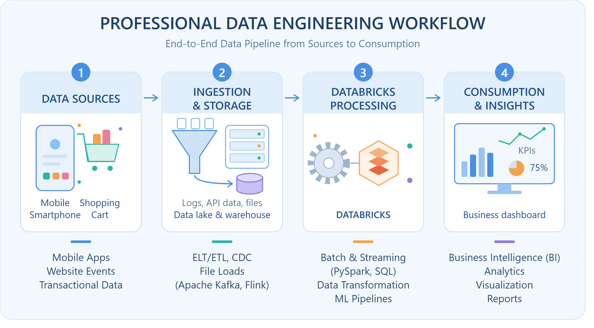

# Behind Every Insight, There Is Data Engineering: Your First Step Toward Building a Data Engineering Portfolio

Every day, millions of people order food online, book cab rides, make digital payments, or stream their favorite shows. Each click, swipe, and transaction generates a massive stream of raw data. 

But have you ever wondered what happens to all this information before it turns into a personalized recommendation, a smooth dashboard, or a business report? How do companies manage millions of concurrent records without crashing? Who ensures that the data is clean, reliable, and ready for analysis?

Welcome to the world of **Data Engineering**—the hidden backbone that makes every data-driven decision possible.

---

## Part 1: What Is Data Engineering?

### What is Data Engineering?
Data Engineering is the practice of designing and building systems for collecting, storing, and analyzing data at scale. While data science and analytics focus on finding patterns and building machine learning models, data engineering focuses on building the **infrastructure**—the pipelines, databases, and architectures—that transport raw data from where it is generated to where it can be used.

### What Does a Data Engineer Do?
A Data Engineer builds and maintains the data pipelines. Their core responsibilities include:
* Designing scalable database architectures (data lakes and data warehouses).
* Extracting data from various source systems, transforming it to ensure quality, and loading it into storage systems (an ETL/ELT process).
* Optimizing data flow and ensuring data security and compliance.

### Where Does Data Come From?
Data originates from a multitude of distributed sources, including:
* **User Interactions:** Clicks, searches, app navigation, and clicks on e-commerce sites.
* **Transactional Systems:** Payment gateways, order checkouts, and inventory logs.
* **IoT & Sensors:** Location data from delivery drivers or smart device telemetry.
* **External APIs:** Social media feeds, financial markets, or weather services.

### Real-World Example: The Food Delivery Ecosystem
Imagine ordering a meal on a food delivery app like Zomato or Swiggy. 
1. **Generation:** When you open the app, search for restaurants, and place an order, your actions generate real-time clickstream and transactional logs.
2. **Collection & Ingestion:** This raw data is streamed instantly into a central ingestion layer (like Apache Kafka or cloud storage buckets).
3. **Processing & Transformation:** The data engineering pipeline cleans up missing values (e.g., incomplete delivery addresses), converts timestamps into standard formats, and joins user profile data with restaurant menus.
4. **Availability:** Finally, the processed data is loaded into a data warehouse, empowering operations teams to track delivery times and data analysts to study peak ordering hours.

---

## Part 2: Why Do We Need Data Engineering?

Imagine a retail company with millions of records spread across legacy databases, Excel sheets, and third-party apps. Without data engineering, this data is messy, isolated, and untrustworthy.

### What Problems Arise Without Proper Data Management?
* **Data Silos:** Teams work in isolation with separate, unshared data sets.
* **Inconsistent Formats:** Dates written as `DD-MM-YYYY` in one system and `MM-DD-YYYY` in another.
* **Duplicate Entries & Missing Values:** Corrupted customer records leading to inaccurate counts.

### The Danger of Bad Data
Making business decisions on incorrect data can lead to catastrophic inventory shortages, misallocated marketing budgets, and poor customer experiences. Data engineering guarantees **data reliability, consistency, and accessibility**.

### OLTP vs. OLAP Systems
To understand how data flows, it helps to distinguish between the systems that handle daily operations and those that handle business intelligence:

| Feature | OLTP (Online Transaction Processing) | OLAP (Online Analytical Processing) |
| :--- | :--- | :--- |
| **Primary Objective** | Running day-to-day business operations | Complex analysis, reporting, and forecasting |
| **Query Type** | Fast, short reads/writes (e.g., update user profile) | Complex, heavy aggregate queries (e.g., total sales by region over 3 years) |
| **Data Structure** | Highly normalized (optimized for speed of insertion/updates) | Denormalized / Star schema (optimized for fast reads and grouping) |
| **Users** | End-users and operational applications | Data Analysts, Data Scientists, and Business Executives |

---

## Part 3: Data Engineer vs. Data Analyst

Let's look at a retail company experiencing declining sales. Who does what to solve this problem?

* **The Data Engineer** builds the automated pipeline that extracts daily sales logs from retail stores, cleans missing fields, structures the data warehouse, and ensures the sales data updates reliably every night.
* **The Data Analyst** queries that clean warehouse, builds visualization dashboards, runs statistical analyses to identify *why* sales dropped in specific categories, and presents insights to the management team.

### Comparison Table: Data Engineer vs. Data Analyst

| Dimension | Data Engineer | Data Analyst |
| :--- | :--- | :--- |
| **Primary Responsibility** | Build, test, and maintain data pipelines and infrastructure. | Analyze data, build dashboards, and extract business insights. |
| **Core Objective** | Make data accessible, clean, reliable, and secure. | Answer business questions and drive strategic decision-making. |
| **Typical Outputs** | Data pipelines, data lakes, data warehouses, and clean tables. | Reports, Power BI/Tableau dashboards, and trend analysis presentations. |
| **Primary Tools** | Python, SQL, Apache Spark, Airflow, Databricks, Git. | SQL, Excel, Power BI, Tableau, Python (Pandas). |
| **Business Contribution** | Ensures the organization has a stable and scalable data foundation. | Translates raw data trends into actionable commercial strategies. |

---

## Part 4: Getting Started with Databricks

Modern data engineering relies on unified platforms like **Databricks**, which bring data engineering, data science, and analytics together on top of a lakehouse architecture.

### A. Databricks Workspace
* **What is it?** A collaborative cloud-based web interface that brings all your data assets, code, dashboards, and machine learning models into one centralized hub.
* **How it helps teams:** It prevents scattered files by allowing data engineers, data analysts, and data scientists to work in the same environment, share notebooks, control access permissions, and manage version history.
* **Key Resources:** Notebooks, data catalogs (Unity Catalog), clusters, and workflows.

### B. Compute
* **What does compute mean?** Compute refers to the processing power (CPU/GPU hardware resources and memory clusters) allocated to run your code and process big data.
* **Why it’s needed:** Laptops have limited RAM and processing power. When dealing with gigabytes or terabytes of records, code cannot run locally. Databricks compute provisions scalable clusters to process massive datasets in parallel.
* **Real-World Analogy:** Think of code as a recipe and data as tons of vegetables. Writing code is like writing down instructions, but **compute** is the commercial kitchen stove and chef crew that actually cooks the meal at scale. Without compute, your recipe stays a piece of paper.

### C. Notebooks
* **What is a Databricks Notebook?** An interactive web-based document that combines executable code blocks, narrative text (Markdown), charts, and math equations.
* **How they are used:** You can mix languages like Python, SQL, Scala, and R within the same workspace. 
* **Cells for Organization:** Notebooks are split into cells. You can write documentation in Markdown in one cell, execute SQL queries in the next, and display Python-based visualizations right below it, making it an ideal tool for exploratory data analysis (EDA).

---

## Conclusion: Connecting It All in a Real Business

Data engineering is the invisible bridge connecting raw chaos to actionable clarity. Whether it's tracking e-commerce inventories, optimizing delivery routes, or powering financial dashboards, everything starts with a reliable data pipeline built on scalable compute engines like Databricks. 

By understanding these foundational concepts, building strong data pipelines, and mastering modern tools, you take your first solid step toward a rewarding career in data engineering!

---

### References & Further Reading

1. **Databricks Documentation & Architecture Overview**  
   * Databricks. *What is Data Engineering?* Explains lakehouse architecture, data engineering pipelines, structured streaming, and unified data processing.  
   * Available at: [Databricks Blog - What is Data Engineering](https://www.databricks.com/blog/what-is-data-engineering)

2. **Fundamentals of Data Engineering & Lifecycle**  
   * Redpanda. *Data Engineering 101: Lifecycle, Best Practices, and Emerging Trends.* Comprehensive guide covering data ingestion, transformation, storage tiers, and real-world streaming pipelines.  
   * Available at: [Redpanda Guides](https://www.redpanda.com/guides/fundamentals-of-data-engineering)

3. **The Data Engineering Lifecycle Structure**  
   * Coursera. *The Data Engineering Lifecycle: From Raw Data to Actionable Insights.* Detailed breakdown of data ingestion, modeling, warehousing, and collaboration workflows across teams.  
   * Available at: [Coursera Articles](https://www.coursera.org/articles/data-engineering-lifecycle)

4. **Cloud Lakehouse Infrastructure & Compute Planes**  
   * LakeFS. *Databricks Architecture Overview: Components & Key Features.* Insights into the Control Plane, Compute Plane, and managing workspaces effectively.  
   * Available at: [LakeFS Technical Blog](https://lakefs.io/blog/databricks-architecture/)
